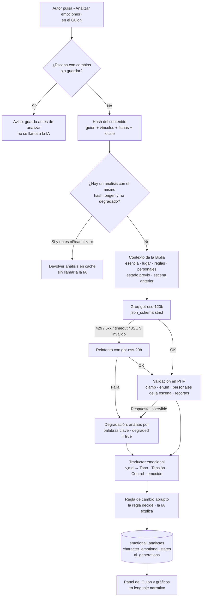

# Modelo de asistencia emocional de Gamerdust (OE2)

Este documento describe el modelo de asistencia con IA emocional y procesamiento de lenguaje natural que Gamerdust usa para analizar, generar y refinar contenido narrativo de videojuegos. Sirve de base para el capítulo del objetivo específico 2 y como referencia técnica del código (`apps/api`).

**Alcance y límites.** No se entrena un modelo propio: se usa un modelo de lenguaje general (Groq, familia *gpt-oss*) guiado por contexto, una salida estructurada y reglas deterministas. El análisis es solo de texto. La IA **propone, pero nunca modifica el texto ni guarda nada** sin que el autor lo confirme.

---

## 1. Trazabilidad con los objetivos específicos

| Objetivo | Qué aporta el modelo |
|---|---|
| **OE1.** Elementos narrativos y emocionales | Los personajes (personalidad, motivación, miedos, límites, estado inicial), los lugares, las reglas del mundo (con su rigidez) y la lista cerrada de 12 emociones son datos del sistema. El modelo los convierte en el **contexto** de cada análisis. |
| **OE2.** Modelo de asistencia con IA emocional y PLN | El pipeline: contexto de la Biblia → LLM con salida JSON estricta → validación en PHP → traductor emocional → regla de cambio abrupto → persistencia (secciones 2 a 8). |
| **OE3.** Interfaz para generar, refinar y vincular lore | El panel de análisis en el Guion, los gráficos de evolución en "Análisis IA", el borrador de ficha de personaje y el refinado de bloques del guion. El contexto sale de los vínculos de la Biblia (`character_scene`, `location_id`, `lore_entry_links`, `character_lore_entry`). |
| **OE4.** Evaluar el impacto | Registro de cada llamada (`ai_generations`), valoraciones 👍/👎 de cada propuesta (`ai_feedback`) y el comando `php artisan gamerdust:ai-metrics`, que exporta las métricas a CSV. |

---

## 2. Pipeline del análisis emocional de una escena



### 2.1 Arquitectura: un contrato con dos implementaciones

- El contrato es `App\Contracts\EmotionAnalyzer`: `analyzeScene(Scene): SceneEmotionResult` y `source()`.
- `GroqEmotionAnalyzer` es la implementación con IA real; se activa cuando existe `GROQ_API_KEY`.
- `KeywordEmotionAnalyzer` adapta el análisis simulado anterior, que cuenta palabras clave. No necesita red y se usa en los tests y como degradación.
- `AppServiceProvider` elige la implementación según `config('gamerdust.ai.driver')` (`groq` | `keywords`).
- El contrato permite sustituir la implementación en el futuro por el motor Python `apps/narrative-engine` sin tocar controladores ni interfaz.

### 2.2 Cuándo se llama a la IA

**Solo cuando el autor pulsa un botón**: *Analizar emociones*, *Reanalizar*, *Refinar con IA* o *Borrador con IA*. Nunca se llama al abrir el Panel del proyecto, al crear o guardar escenas, ni desde eventos u observers. Así el coste queda bajo control y el autor decide en todo momento.

---

## 3. Representación emocional: "VAD invisible"

### 3.1 Por qué VAD

Internamente cada estado emocional se representa con tres dimensiones continuas en la escala 0–1:

- **Valencia (v)**: de desagradable a agradable.
- **Activación (a)**: de calma a máxima tensión o excitación.
- **Dominancia (d)**: de estar a merced de la situación a dominarla.

Es el modelo PAD/VAD de Mehrabian y Russell (Mehrabian, 1996; Russell, 1980), el mismo que usa el léxico NRC-VAD (Mohammad, 2018). Se eligió por cuatro razones:

1. **Es continuo y comparable**: permite medir distancias entre estados y detectar cambios bruscos con una regla numérica reproducible, cosa que no permite una etiqueta discreta.
2. **Separa ritmo y tono**: la activación funciona como "tensión" narrativa (ritmo) y la valencia como "tono". Son las dos curvas que un diseñador narrativo mira en un arco.
3. **La dominancia distingue emociones** que comparten valencia y activación, como el miedo (sin control) y la ira (con control), muy relevantes para la agencia del personaje.
4. **La escala 0–1 es la del léxico NRC-VAD**, lo que facilita una futura validación contra ese recurso.

### 3.2 Por qué "invisible"

El diseñador narrativo no conoce el modelo VAD. Por eso la interfaz normal **nunca** muestra "valencia", "activación", "dominancia" ni "VAD": las dimensiones se traducen a lenguaje narrativo. Un interruptor de **modo técnico**, apagado por defecto, muestra los valores crudos para la defensa ante el tribunal.

| Interno | Etiqueta visible | Bandas (límite superior exclusivo) |
|---|---|---|
| v | **Tono** | < 0,2 Muy negativo · < 0,4 Negativo · < 0,6 Neutral · < 0,8 Positivo · ≥ 0,8 Muy positivo |
| a | **Tensión** | < 0,35 Baja · < 0,65 Media · ≥ 0,65 Alta |
| d | **Control del personaje** | < 0,35 Vulnerable · < 0,65 En equilibrio · ≥ 0,65 Con el control |
| (v, a, d) | **Emoción** | La de centroide más cercano (sección 3.3) |

Umbrales, centroides y colores viven en un único lugar, `config/gamerdust.php`. El frontend los recibe del servidor y no repite ningún número.

### 3.3 Lista de emociones y centroides

La lista es cerrada y tiene 12 emociones. Se partió de las 5 claves que ya usaba el análisis simulado (joy, fear, anger, sadness y tension) y se añadieron las que faltaban para cubrir el espacio VAD: emociones positivas de baja activación (calma, ternura), emociones prospectivas (esperanza, ansiedad), la sorpresa, la culpa, el rechazo y un estado neutro.

La antigua clave `tension` no es una emoción sino la dimensión de activación, así que se reasigna a `anxiety`. Las filas antiguas, en escala −1..1 y sin `content_hash`, no se mezclan con las nuevas.

Los centroides son **valores de diseño aproximados**, derivados del modelo PAD de Mehrabian y del circumplejo de Russell, y se pueden ajustar.

| Clave | Emoción | v | a | d |
|---|---|---|---|---|
| joy | Alegría | 0,85 | 0,65 | 0,65 |
| hope | Esperanza | 0,75 | 0,50 | 0,55 |
| tenderness | Ternura | 0,88 | 0,40 | 0,55 |
| calm | Calma | 0,72 | 0,20 | 0,60 |
| surprise | Sorpresa | 0,60 | 0,85 | 0,45 |
| neutral | Neutral | 0,50 | 0,40 | 0,50 |
| anxiety | Ansiedad | 0,25 | 0,75 | 0,30 |
| fear | Miedo | 0,10 | 0,85 | 0,15 |
| sadness | Tristeza | 0,15 | 0,25 | 0,25 |
| guilt | Culpa | 0,15 | 0,45 | 0,20 |
| anger | Ira | 0,10 | 0,85 | 0,75 |
| disgust | Rechazo | 0,10 | 0,55 | 0,60 |

El traductor emocional (`EmotionTranslator`) es una clase pura, sin IA ni base de datos, con tests unitarios de cada borde de umbral. Tiene tres funciones:

- `labels(v, a, d)` devuelve tono, tensión y control.
- `nearestEmotion(v, a, d)` devuelve la emoción cuyo centroide está a menor distancia euclídea.
- `fromAuthor(emoción, intensidad)` devuelve el centroide de la emoción elegida por el autor, con la activación sustituida según la intensidad (baja 0,25 · media 0,50 · alta 0,80). Así el autor define el **estado inicial** de un personaje sin tocar números.

---

## 4. Contexto que recibe el modelo

`SceneContextBuilder` construye el contexto a partir de los vínculos que el autor ya creó en la Biblia Narrativa:

| Elemento | Origen |
|---|---|
| Esencia del proyecto | `projects` (título, género, idioma, premisa, conflicto principal) y `project_constraints` (tema, tono, ambientación) |
| Lugar de la escena | `scenes.location_id` |
| Reglas del mundo | Reglas vinculadas al lugar (`lore_entry_links`) y a cada personaje (`character_lore_entry`, con su papel: la rompe o la impone), con su rigidez |
| Personajes | `character_scene`, con personalidad, motivación, miedos, límites y descripción recortada (~300 caracteres) |
| Estado previo de cada personaje | Su estado en la escena anterior analizada más cercana, por orden de guion → si no hay, su **estado inicial definido por el autor** → si tampoco, "sin estado previo" |
| Escena anterior | El último análisis de la escena anterior analizada más cercana (para detectar saltos de tono) |
| Texto de la escena | La versión **guardada**, reconstruida conservando quién habla (`MARA (en voz baja): No vuelvas.`) |

**Presupuesto.** El texto se recorta a 1.800 palabras (se marca como `truncated`). Se envían como máximo 8 elementos de contexto: primero los personajes, luego el lugar y después las reglas. Cada petición queda muy por debajo de los ~6.000 tokens: en la prueba real, una escena con dos personajes, un lugar y una regla usó 2.462 tokens y tardó 2,7 s.

**Idiomas.** `projects.language` es el idioma de la narrativa: las evidencias se citan literalmente en ese idioma. Las explicaciones y sugerencias se escriben en el idioma de la interfaz en el momento del análisis.

---

## 5. Prompt del sistema y salida estructurada

### 5.1 Prompt del sistema (análisis de escena)

Lo genera `ScenePrompt::system()`. Esta es la versión en español, con un proyecto escrito en español:

```text
Eres un asistente de diseño narrativo para videojuegos. Tu trabajo es LEER y EVALUAR;
nunca reescribes la historia ni decides por el autor.

Dimensiones (0 a 1):
- v (valencia): 0 muy desagradable/negativo · 0.5 neutro · 1 muy agradable/positivo.
- a (activación): 0 calma total · 0.5 moderado · 1 máxima tensión o excitación.
- d (dominancia): 0 sin control, a merced · 1 domina la situación.
"emotion" debe ser exactamente una de: joy, hope, tenderness, calm, surprise, neutral, anxiety, fear, sadness, guilt, anger, disgust.

Reglas:
1. Basa cada valor en el texto. "evidence" es una cita breve y LITERAL de la escena
   (máx. 15 palabras), en el idioma original de la escena (español).
2. Analiza solo a los personajes de la lista PERSONAJES que actúan o hablan en la escena,
   con su character_id exacto. No inventes personajes.
3. "out_of_character" = true solo si una acción o diálogo contradice claramente la
   personalidad, motivación o miedos de su ficha; explica en "out_of_character_reason"
   (cadena vacía si es false).
4. Compara cada personaje con su ESTADO PREVIO: en "change_explanation" di qué ocurre en
   la escena que explica el cambio; "change_justified" = true si el texto muestra una
   causa clara (o si casi no hubo cambio o no hay estado previo).
5. "inconsistencies": solo contradicciones reales con el LUGAR, las REGLAS DEL MUNDO
   (ten en cuenta su rigidez) o la esencia del proyecto. En "contradicts" escribe el
   nombre exacto de la ficha contradicha. Si no hay, lista vacía.
6. "suggestions": de 1 a 3, concretas, como propuestas descartables. Nunca devuelvas la
   escena reescrita.
7. Escribe "summary", explicaciones y sugerencias en español, en lenguaje claro,
   sin mencionar valencia, activación, dominancia ni VAD.
8. Si el texto es muy breve o ambiguo, usa "neutral" con valores cercanos a 0.5 y dilo
   en "summary".
9. En "scene", compara el tono con la ESCENA ANTERIOR: "change_justified" = true si el
   texto explica el salto (o si no hay escena anterior) y "change_explanation" lo resume.
```

El mensaje de usuario contiene, en este orden: `PROYECTO`, `ESENCIA`, `LUGAR`, `REGLAS DEL MUNDO`, `PERSONAJES` (con `[character_id:N]`), `ESTADO PREVIO` (emoción, v/a/d y origen: autor, IA o ninguno), `ESCENA ANTERIOR` y, por último, el código, el acto, el título y el texto de la escena.

### 5.2 Esquema JSON (`scene_emotion_analysis`, modo estricto)

En modo estricto (`strict: true`), todas las propiedades son obligatorias y `additionalProperties` es `false` en cada objeto. No se usan `minimum`/`maximum`: el rango se valida en PHP. La versión completa la genera `ScenePrompt::schema()`.

```json
{
  "scene": {
    "v": "number", "a": "number", "d": "number",
    "emotion": "enum(12 emociones)",
    "summary": "string", "evidence": "string",
    "change_justified": "boolean", "change_explanation": "string"
  },
  "characters": [{
    "character_id": "integer", "name": "string",
    "v": "number", "a": "number", "d": "number",
    "emotion": "enum(12 emociones)", "evidence": "string",
    "out_of_character": "boolean", "out_of_character_reason": "string",
    "change_justified": "boolean", "change_explanation": "string"
  }],
  "inconsistencies": [{
    "fragment": "string", "contradicts": "string", "explanation": "string",
    "severity": "enum(low, medium, high)"
  }],
  "suggestions": [{
    "kind": "enum(emotion, coherence, pacing, conflict)",
    "text": "string", "why": "string"
  }]
}
```

### 5.3 Validación posterior en PHP

La comunidad reporta fallos intermitentes del modo estricto, así que cada respuesta se valida (`SceneResultValidator`):

- **Valores:** v, a y d se acotan a [0, 1]; un valor no numérico pasa a 0,5.
- **Emociones:** una emoción fuera de la lista se sustituye por la emoción más cercana a sus valores.
- **Personajes:** se descartan los `character_id` que no pertenecen a la escena, y los duplicados.
- **Textos:** las evidencias se recortan a 160 caracteres y los textos largos a 600.
- **Límites:** como máximo 3 sugerencias y 10 incoherencias; los enumerados inválidos toman un valor seguro.
- **Respuesta inservible:** si falta el objeto `scene`, el análisis se degrada.

---

## 6. División metodológica: la regla decide, la IA explica

Detectar un cambio emocional abrupto **no se deja a la IA**. Lo decide una regla determinista (`EmotionChangeDetector`):

```text
delta  = max(|Δv|, |Δa|, |Δd|)     frente al estado previo
abrupto = delta > 0,40              (gamerdust.emotion.abrupt_threshold)
```

| ¿Abrupto? (regla) | ¿Justificado? (IA) | Resultado |
|---|---|---|
| No | — | Sin aviso |
| Sí | No / sin explicación | 🔴 **Alerta roja**: "Cambio emocional brusco sin una causa visible en la escena" |
| Sí | Sí | 🟠 **Aviso ámbar**: "Cambio fuerte, pero el texto lo justifica" + la explicación de la IA |

Se aplica a cada personaje frente a su estado previo y a la escena frente a la escena anterior analizada (salto de tono).

**Por qué esta división.** El criterio de "abrupto" es reproducible, auditable y ajustable con un solo parámetro, y no depende de la variabilidad del modelo. La IA aporta lo que una regla no puede: leer el texto y explicar *por qué* cambia el personaje. Así se combinan la fiabilidad de las reglas con la comprensión del lenguaje de un LLM, y cada alerta se puede justificar ante el autor y ante el tribunal.

---

## 7. Robustez: respaldo, degradación y caché

| Situación | Comportamiento |
|---|---|
| El modelo principal (`openai/gpt-oss-120b`) responde | `status = ok` |
| 429, 5xx, timeout, error de esquema o JSON truncado | Se reintenta una vez con `openai/gpt-oss-20b` → `status = fallback` |
| Ambos fallan (análisis de escena) | Se degrada al análisis por palabras clave (`degraded = true`, `status = degraded`) y la interfaz avisa: "La IA está ocupada; se muestra un análisis básico por palabras clave." |
| Ambos fallan (generar o refinar) | Sin degradación: mensaje amable (HTTP 503) y la edición sigue |
| Clave inválida (401) | No se reintenta; error registrado |

Si no hay clave configurada, todo funciona con palabras clave y nunca se bloquea la edición.

**Caché por contenido.** `content_hash` es el sha256 de:

- el guion, el título y el acto de la escena;
- los IDs y el `updated_at` de los personajes, del lugar y de las reglas vinculadas;
- la esencia del proyecto y el idioma de la interfaz.

Si el autor pulsa *Analizar* y ya existe un análisis con el mismo hash, del mismo origen y no degradado, se devuelve sin llamar a Groq. *Reanalizar* fuerza una llamada nueva. Cuando el hash cambia, el análisis anterior se marca como desactualizado en el panel y aparece en gris en los gráficos.

**Configuración de la llamada.** `temperature 0.3`, `reasoning_effort low` (los modelos gpt-oss dedican menos tokens a razonar), `include_reasoning false` (solo se recibe el JSON), `max_completion_tokens 2000` y un timeout de 15 s por intento.

---

## 8. Límites del plan gratuito de Groq y medidas tomadas

Estos son los límites de la documentación de Groq para cada modelo (gpt-oss-120b y gpt-oss-20b), consultada en noviembre de 2026:

| Límite | Valor | Medida en Gamerdust |
|---|---|---|
| Peticiones por minuto | 30 | Limitador propio: 10 llamadas de IA por usuario y minuto |
| Peticiones por día | 1.000 | Caché por hash y llamadas solo bajo demanda |
| Tokens por minuto | 8.000 | Texto ≤ 1.800 palabras, ≤ 8 elementos de contexto, campos recortados; ~2.500 tokens por análisis medido |
| Tokens por día | 200.000 | Unos 80 análisis de escena diarios por modelo; el respaldo usa la cuota del otro modelo |

Mediciones reales (escena de ejemplo, en español):

| Operación | Modelo | Tokens | Latencia |
|---|---|---|---|
| Análisis de escena (2 personajes) | gpt-oss-120b | 2.462 | 2,7 s |
| Borrador de personaje | gpt-oss-120b | 1.267 | 1,9 s |
| Refinar un diálogo | gpt-oss-120b | 699 | 0,8 s |

---

## 9. Generar y refinar (verbos del OE3)

- **Generar borrador de ficha de personaje** (`CharacterDraftService`):
  - **Entrada:** una idea breve del autor, más la esencia del proyecto y los nombres de los personajes, lugares y reglas existentes, para no duplicar ni contradecir.
  - **Salida:** solo campos que existen en `characters`, más la emoción e intensidad iniciales.
  - **Uso:** el borrador **rellena el formulario sin guardar** y avisa si el nombre ya existe. Nunca sobrescribe una ficha.
- **Refinar un bloque del guion** (`BlockRefineService`):
  - **Entrada:** un bloque y un objetivo (más tensión, más esperanza, más claro, más conciso, o fiel a la personalidad de un personaje), con una indicación opcional. El contexto son los personajes, el lugar y las reglas de la escena, y el texto guardado de la escena.
  - **Salida:** la propuesta, la lista de cambios y la emoción resultante.
  - **Uso:** *Aplicar* solo modifica el borrador local del editor, entra en deshacer/rehacer y se guarda cuando el autor pulsa Guardar (y crea una versión, como siempre). El servidor no modifica la escena.

---

## 10. Evaluación (OE4)

- **`ai_generations`**: una fila por llamada, con tipo (`scene_analysis`, `character_draft`, `refine`), modelo, estado (`ok`, `fallback`, `degraded`, `error`), tokens, latencia y hash de la entrada. Nunca se registra la clave.
- **`ai_feedback`**: los votos 👍/👎 del autor sobre cada sugerencia del análisis (`emotional_analysis_id` + índice), cada propuesta de refinado y cada borrador (`ai_generation_id`).
- **`php artisan gamerdust:ai-metrics {proyecto?} --output=f.csv`** exporta:
  - llamadas por tipo y estado, latencia y tokens medios, y porcentaje de respaldo y de fallo;
  - análisis por origen;
  - votos y porcentaje de propuestas útiles;
  - alertas rojas y ámbar (de personaje y de escena) y salidas de personaje.

---

## 11. Decisiones tomadas

1. **Contrato con dos implementaciones** en lugar de sustituir el servicio simulado: así hay degradación, tests sin red y un camino hacia `apps/narrative-engine`.
2. **Reutilizar las claves de emoción existentes** y ampliarlas a 12. `tension` se reasigna a `anxiety`, porque la tensión es una dimensión (activación) y no una emoción.
3. **"VAD invisible"**: la interfaz solo habla de Tono, Tensión y Control del personaje; los valores crudos aparecen solo en el modo técnico.
4. **Una sola fuente de verdad** (`config/gamerdust.php`) para umbrales, centroides y colores; el frontend no duplica números.
5. **La regla decide y la IA explica** el cambio abrupto (sección 6). La explicación se extiende también al nivel de escena (`change_justified` y `change_explanation` en `scene`) para explicar los saltos de tono.
6. **El análisis usa siempre la versión guardada** y vincula cada análisis a su `SceneVersion`, de modo que el resultado es reproducible.
7. **El estado previo** de un personaje sigue esta prioridad: estado detectado por la IA en la escena anterior → estado inicial del autor → ninguno. El estado inicial se elige como emoción e intensidad, sin deslizadores numéricos.
8. **Caché por hash del contenido y llamadas solo bajo demanda**, para respetar el plan gratuito. Un análisis degradado no se reutiliza.
9. **Validación siempre en PHP**, aunque se use el modo estricto.
10. **Generar y refinar no degradan a palabras clave**: una propuesta de baja calidad sería peor que un aviso.
11. **Recharts** para los gráficos, cargado aparte (`React.lazy`) para no aumentar el peso del resto de páginas.
12. **Fuera de alcance**: chat conversacional, extracción automática de entidades, colas en segundo plano (el análisis es síncrono con timeout), audio e imagen. El análisis con Groq de nodos de diálogo del editor de ramificación queda como trabajo futuro; hoy esos nodos usan el análisis por palabras clave.

---

## Referencias

- Mehrabian, A. (1996). Pleasure-arousal-dominance: A general framework for describing and measuring individual differences in temperament. *Current Psychology*, 14(4), 261–292.
- Mohammad, S. M. (2018). Obtaining reliable human ratings of valence, arousal, and dominance for 20,000 English words. *Proceedings of the 56th Annual Meeting of the ACL*, 174–184.
- Russell, J. A. (1980). A circumplex model of affect. *Journal of Personality and Social Psychology*, 39(6), 1161–1178.
- Groq. *Structured Outputs*, *Reasoning* y *Rate Limits*. Documentación de la API de GroqCloud (console.groq.com/docs), consultada en noviembre de 2026.
